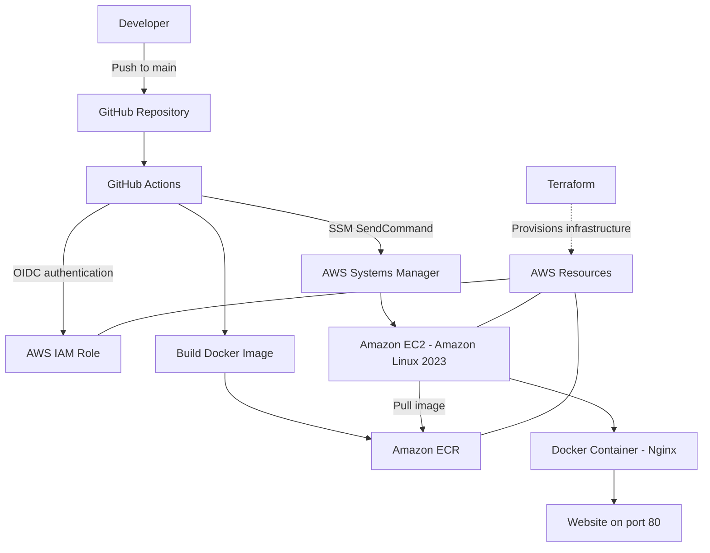

# AWS Docker CI/CD Pipeline with Terraform

An end-to-end DevOps project demonstrating Infrastructure as Code (IaC), Docker containerization, automated image publishing, and deployment to AWS using Terraform, GitHub Actions, Amazon ECR, and AWS Systems Manager.

## Project Overview

This project automates the deployment of a static website packaged in a Docker container running Nginx on Amazon EC2.

Terraform provisions the AWS infrastructure, while GitHub Actions automates the CI/CD workflow. GitHub OIDC provides temporary AWS credentials, and AWS Systems Manager (SSM) executes deployment commands on the EC2 instance.

## Architecture



## Technologies Used

- **Cloud:** Amazon Web Services (AWS)
- **Infrastructure as Code:** Terraform
- **Containerization:** Docker
- **Container Registry:** Amazon Elastic Container Registry (ECR)
- **Compute:** Amazon EC2
- **CI/CD:** GitHub Actions
- **Authentication:** GitHub OpenID Connect (OIDC) and AWS IAM roles
- **Remote Command Execution:** AWS Systems Manager Run Command
- **Web Server:** Nginx
- **Operating System:** Amazon Linux 2023
- **Version Control:** Git and GitHub

## Project Features

- Provision AWS infrastructure using Terraform.
- Build a Docker image for a static website served by Nginx.
- Push versioned Docker images to Amazon ECR using the Git commit SHA.
- Authenticate GitHub Actions to AWS using OIDC and an IAM role.
- Deploy the application to EC2 through AWS Systems Manager.
- Use an EC2 instance role to authenticate to ECR and pull images.
- Run the Docker container with automatic restart enabled.
- Perform an HTTP health check after deployment.
- Attempt to restore the previous image if deployment fails.

## CI/CD Workflow

1. A developer pushes code to the `main` branch.
2. GitHub Actions checks out the repository.
3. GitHub Actions assumes an AWS IAM role using OIDC.
4. Docker builds an image from the Dockerfile.
5. The image is tagged with the Git commit SHA and pushed to Amazon ECR.
6. GitHub Actions sends a deployment command through AWS Systems Manager.
7. The EC2 instance authenticates to ECR using its IAM role and pulls the new image.
8. The deployment script replaces the running container.
9. An HTTP health check verifies that the website responds locally.
10. GitHub Actions retrieves the SSM command result and reports success or failure.

## Repository Structure

```text
Docker-lab/
├── .github/
│   └── workflows/
│       └── ci.yml
├── Dockerfile
├── .dockerignore
├── index.html
└── README.md
```

## Run Locally with Docker

Clone the repository:

```bash
git clone https://github.com/MEGendy/Docker-lab.git
cd Docker-lab
```

Build the image:

```bash
docker build -t docker-lab .
```

Run the container:

```bash
docker run -d --name my-web -p 8080:80 docker-lab
```

Open the website at:

```text
http://localhost:8080
```

To stop and remove the local container:

```bash
docker rm -f my-web
```

## Security Considerations

- Use GitHub OIDC and IAM roles instead of long-lived AWS access keys in GitHub Actions.
- Apply least-privilege IAM permissions to deployment and image access.
- Keep Terraform state files, private keys, AWS credentials, and sensitive variable files out of version control.
- Restrict inbound network access to the ports and sources actually required.
- Review AWS resource costs and clean up resources when the project is no longer needed.

## Future Improvements

- Add Amazon CloudWatch dashboards, logs, metrics, and alarms.
- Improve deployment health checks and rollback reliability.
- Reduce deployment downtime with a safer deployment strategy.
- Introduce an Application Load Balancer and Auto Scaling Group.
- Add automated application tests and deployment approval controls.

## Project Screenshots

### GitHub Actions CI/CD Pipeline


## Author

**Mohamed Emad Elgendy**

GitHub: [MEGendy](https://github.com/MEGendy)

Project repository: [Docker-lab](https://github.com/MEGendy/Docker-lab)
